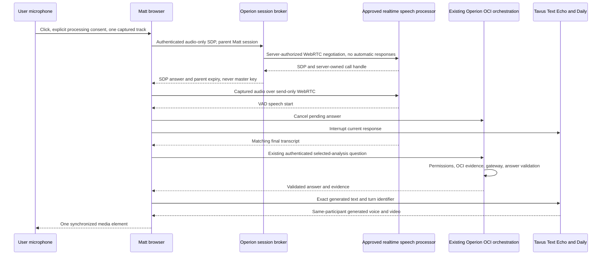

# Matt real-time architecture assessment

Date: 2 November 2026. Scope: isolated local work only.

**LOCAL INTEGRATION IMPLEMENTED — AWAITING PROVIDER ACTIVATION.**
This milestone is not live Matt acceptance, production readiness or permission
to activate a provider.

## Decision

**Recommendation:** use an independently gated OpenAI Realtime WebRTC audio
input, Operion-owned reasoning, and the existing Tavus Text Echo output.
The new local implementation uses a documented `realtime` session with automatic
responses disabled, VAD and input transcription. It is not a provider chatbot.
It does not use OpenAI speech output or browser voice synthesis.

**Fallback design:** Tavus full CVI pipeline, with its STT/turn taking/TTS and
avatar, calling an authenticated Operion-owned OpenAI-compatible streaming LLM
endpoint. This fallback is documented, not implemented or automatically selected.
Secure callback-to-user/tenant/analysis binding is prerequisite work, not a
matter of giving Tavus a general contract API key.

Why primary: it preserves the already reviewed evidence/answer boundary,
does not require a public provider callback into OCI, reuses Matt's output
identity/voice/session integration, replaces the restrictive browser-STT
dependency, and supports VAD-triggered interruption while capture continues.
Two media connections and serial STT -> reasoning -> TTS/rendering introduce
latency and operational complexity. Those costs must be measured, not hidden.

## Before this milestone: source-verified path

Implemented: capture/permission lifecycle; captured-track browser recognition
API wiring; session ownership; authorized OCI readers; budgeted model gateway;
evidence-ID validation; Tavus HTTP/Daily output adapter; once-only intro.

Not established: physical capture, actual browser STT, real model/provider
activation, actual fixed Matt voice, human audibility or lip-sync. Public demo
responses remain prepared and labelled until separately approved live activation.
The subsequent [Demo parity implementation](DEMO_MATT_FULL_FEATURE_PARITY_ACCEPTANCE_REPORT.md)
adds server-authorized prepared context to this same engine; it does not establish
genuine provider acceptance. Test substitutions are confined to tests.

The earlier defect was not solvable by putting the microphone in Text Echo:
Tavus explicitly disables microphone input there. Microphone Echo renders
pre-generated audio; it does not transcribe the user or invoke Operion.

## New local architecture

**Implemented locally:** server SDP broker and hangup; separate approval gates;
provider-neutral lifecycle seams; actual captured-track WebRTC; outbound RTP
checks; matching final transcript delivery; VAD barge-in; cancellation wait;
continuous follow-ups; temporary input recovery; coupled cleanup; expiry.

**Externally blocked:** all genuine speech processing, voice/video rendering,
identity enrollment, account permissions, costs, physical acceptance and legal
processing authority. The new path is not enabled by default.

## Operion remains the intelligence

- Speech provider receives microphone audio, not OCI tools or contract storage.
- Final transcript is untrusted input, never a document authority or tenant ID.
- Existing middleware derives user/organization scope. Session ownership and
  selected-analysis readers enforce access; no provider can name another tenant
  in a callback because this implementation has no provider callback route.
- Existing model gateway controls business reasoning and budget confirmation.
  Answer text must satisfy existing output/evidence checks before avatar delivery.
- The gateway module also owns the Realtime HTTP transport. Speech remains a
  separately approved and billed service: its calls do not consume the text
  intelligence budget, and its own privacy, spending and session controls remain
  mandatory.
- Only generated answer text goes to Tavus. That text can itself be confidential;
  separating processors does not eliminate the need for authority/agreements.
- Realtime automatic response and interruption flags are false, output modality
  is text, and tools are empty. No `response.create` is sent. Unexpected inference
  or incoming speech-provider media causes input termination.

A modified browser can submit arbitrary questions, as it can with typed input;
every question still passes existing backend authorization. Local browser controls
are not claimed as tamper-proof provider-side spending enforcement.

## What remains deliberately unchanged

The introduction plays once, can be skipped, and never substitutes for an answer.
Original protected source/worktrees and prior local fixes are preserved.
Default input remains the explicitly labelled browser path until an operator
selects and approves real-time audio. There is no automatic failover between
processors and no generic replacement for Matt's identity.

Current session history is bounded and analysis-specific, not persistent memory.
Full spoken answers are generated/validated before rendering; this is not yet a
streaming-token-to-voice engine. Emotional perception is not supported in Echo.
Naturalness, aviation terminology accuracy, long pauses, self-interruption,
speaker feedback and actual latency require genuine acceptance.

## Evidence and next decision

See [provider comparison](MATT_PROVIDER_COMPARISON.md) for official capability,
pricing and privacy sources accessed on the research date; [integration
design](MATT_LIVE_INTEGRATION_DESIGN.md) for actual interfaces; [activation
checklist](MATT_EXTERNAL_ACTIVATION_CHECKLIST.md) for approval boundaries; and
[local test report](MATT_REALTIME_LOCAL_TEST_REPORT.md) for measured local results.

Next: approve or reject this processor split and its data flow, establish
account/legal/budget/identity prerequisites, then authorize a bounded synthetic-
data provider test. No credential sharing in chat, identity upload or paid
session is needed to review this recommendation.
