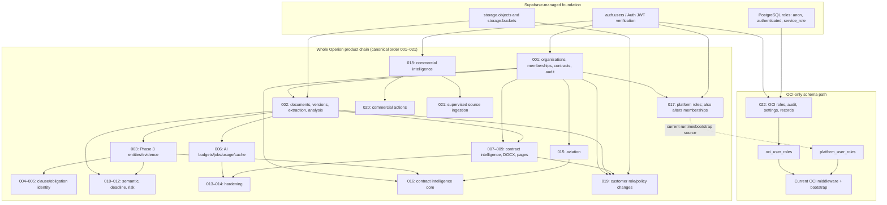

# OCI Clean-Project Migration Dependency Audit

## Verdict

**REMEDIATION REQUIRED — DESIGN ESTABLISHED.**

The source establishes that `022_oci_foundation.sql` is independent of the
customer application schema and of `platform_user_roles`. It depends on the
Supabase-managed Auth schema (`auth.users`) and standard PostgreSQL/Supabase
facilities. The *current OCI application and bootstrap are not independent*:
they additionally require and mutate the broad platform role table created by
migration 017. A clean project can receive the OCI schema without migrations
001–021, but cannot currently run the complete OCI authorization/bootstrap path
without a `platform_user_roles` table.

No code, migration, identity, provider resource, or database was changed or
accessed. This is a source-level finding only; migration 022 has not been
executed against a clean database. The earlier conclusion that migration 022
itself references `platform_user_roles` was inaccurate. The dependency is in
middleware/bootstrap and in the conventional whole-repository migration
runner, not in migration 022's SQL.

## Scope and evidence

Inspected all 22 files in `supabase/migrations`, the migration validation and
clean-room harnesses, OCI and platform authorization middleware, Auth UI,
bootstrap script, identity architecture documentation, and role-related tests.
The authoritative worktree remains on branch `dev/oci-europe-increment-a` at
`8720815dcea6811326051166e41ba44d61395011`; existing work was preserved.

The source test `test/clean-room-migration-rehearsal.js` currently expects
exactly 21 canonical migrations (`001`–`021`) and omits the OCI migration from
its expected tables, functions, RLS inventory and assertions. The Supabase
validation script similarly targets the Phase 3/customer chain, not an
OCI-only project. Neither test proves that migration 022 executes on a clean
Supabase project.

## Findings

### SQL migration 022 is OCI-schema-only

[`022_oci_foundation.sql`](../supabase/migrations/022_oci_foundation.sql):

* Creates four tables: `oci_user_roles`, `oci_audit_events`, `oci_settings`,
  and `oci_records`.
* Uses Supabase-managed `auth.users` foreign keys for the OCI role, audit actor,
  and role creator. It uses no `profiles`, `organization_memberships`,
  `platform_user_roles`, permissions table, customer contract table, or
  customer-specific function.
* Uses self-references from `oci_records` to that same table.
* Creates OCI-only indexes, validation/audit functions, and triggers.
* Enables RLS on the four OCI tables; revokes access from `public`, `anon`, and
  `authenticated`; grants narrowly enumerated table operations to
  `service_role`; and revokes direct execution of its trigger functions from
  those client roles.
* Does not create an Auth user or any role assignment. Its initial
  `oci_settings` stages row is application configuration, not an identity or
  privilege.
* Does not call `public.is_organization_member`, reference
  `organization_memberships`, or require the `pgcrypto` extension. Its
  `gen_random_uuid()` calls rely on the PostgreSQL function available in the
  supported Supabase PostgreSQL baseline.
* Has no `IF NOT EXISTS` on its new tables/functions/triggers and is therefore
  a one-time migration, not a rerunnable SQL script. Its transaction block
  does not make reapplication safe after a successful commit.

### `platform_user_roles` belongs to the wider platform application schema

[`017_platform_identity_foundation.sql`](../supabase/migrations/017_platform_identity_foundation.sql)
creates `public.platform_user_roles` with a foreign key to `auth.users`, a
role allowlist (`SUPERADMIN`, `OPERION_ADMIN`, `OPERION_ANALYST`), active/revoked
status, a composite primary key, and a partial active-role index. It enables
RLS, revokes access from `anon` and `authenticated`, and grants all table
privileges to `service_role`.

However, before creating that table, migration 017 alters
`public.organization_memberships` to broaden its role check. That relation is
created by [`001_phase1_foundation.sql`](../supabase/migrations/001_phase1_foundation.sql),
which also creates the broader organization, contract, version, clause,
obligation, and audit schema and the tenant membership helper. Thus, applying
017 as written requires the customer/platform foundation in 001; 017 is not an
OCI-only identity migration.

The separate customer-role migration
[`019_customer_role_foundation.sql`](../supabase/migrations/019_customer_role_foundation.sql)
changes `organization_memberships`, customer contract/document read policies,
and storage policies. It does not create, authorize, or refer to
`platform_user_roles`. Organization membership roles and internal platform
roles are deliberately separate authorities in
[`IDENTITY_ROLE_ARCHITECTURE.md`](IDENTITY_ROLE_ARCHITECTURE.md).

### Complete reference inventory for `platform_user_roles`

| Reference | Use | Consequence |
|---|---|---|
| `supabase/migrations/017_platform_identity_foundation.sql` | Creates table, Auth FK, role/status constraints, index, RLS and grants; first alters customer membership roles | Requires the 001 membership table and brings the shared platform role model with it |
| `middleware/superAdminMiddleware.js` | Reads active platform roles for generic protected platform endpoints | Platform API guards depend on the shared platform role model |
| `middleware/ociAccessMiddleware.js` | Joins `oci_user_roles` to `platform_user_roles` and requires both `oci.super_admin` and active `platform.SUPERADMIN` | OCI inherits a second global platform authorization condition |
| `scripts/bootstrap-oci-superadmin.js` | Reads, checks, inserts/reactivates the platform `SUPERADMIN` row, then inserts OCI role and audit | A successful OCI bootstrap also creates a broader platform grant |
| `test/identity-architecture.test.js` | Asserts 017/platform-vs-tenant role structure | Static platform architecture regression coverage |
| `test/oci-access.test.js` | Mocks platform role queries and bootstrap inserts | Current OCI tests encode the dual-role bootstrap contract |
| `test/oci-workflows.test.js` | Asserts OCI SQL joins the platform table | Current middleware test encodes the dual-role requirement |
| `test/clean-room-migration-rehearsal.js` | Includes platform table in the 001–021 full-product expected schema | Tests the broad product chain, not standalone OCI |
| `test/supabase-validation.js` | Requires migration 017 and the platform table | Tests a phase/product migration sequence, not standalone OCI |
| `docs/IDENTITY_ROLE_ARCHITECTURE.md`, OCI deployment/provisioning reports | Describe shared platform authorization or the former dependency conclusion | Documentation must distinguish SQL dependency from runtime dependency |

No migration defines an identity `profiles` table, a general permissions table,
or an OCI dependency on organization membership. The `contract_intelligence_profiles`
table is an application-analysis table, not a Supabase user profile. The
customer role model is `organization_memberships`; the internal application
role model is `platform_user_roles`; the OCI-specific model is
`oci_user_roles`.

## Migration dependency graph

This graph separates **the whole-product deployment sequence** from the
**OCI-only schema path**. The first is the repository's existing canonical
application chain; it is not a requirement for `022` itself.

The numbered product chain is the migration order enforced by the existing
clean-room harness. The arrows in that branch show material object dependencies
and broad rollout order; they do not claim every adjacent migration has a direct
SQL reference to the next one. Migration 022 is independent at SQL level but is
currently stored beside the product-chain files, while the repository's
whole-chain harness still asserts a 21-file set. A clean-project deployment
must use an explicit OCI-only migration target rather than blindly applying
the shared directory.

## Current identity and bootstrap flow

### Request authorization

[`verifyOciIdentity`](../middleware/ociAccessMiddleware.js) asks Supabase Auth
to validate the bearer token; it then checks subject, issuer, audience,
expiration, and confirmed email. The middleware queries the database for an
active `oci_user_roles` row **and** an active `SUPERADMIN` row in
`platform_user_roles`, then requires `aal2`, records an audit event, and only
then continues. Role claims in frontend metadata or headers do not authorize
requests.

The database role table is not directly accessible to `anon` or
`authenticated`; the backend/operator is the authorization boundary.
`oci_user_roles` itself already provides a specific OCI grant, active/revoked
status, an Auth-user foreign key, and role-change auditing.

### Bootstrap

[`bootstrap-oci-superadmin.js`](../scripts/bootstrap-oci-superadmin.js) is
verify-only by default and mutates only with `--apply`. It verifies a confirmed
Auth identity and `aal2`, and compares the identity email to
`OCI_BOOTSTRAP_EMAIL`. The expected email is supplied by environment; the code
does not pin it to `meelis@operionos.com`.

On an empty OCI role table, the transaction locks bootstrap, checks existing
OCI/platform roles, inserts or reactivates the global platform `SUPERADMIN`,
inserts the OCI `super_admin`, writes an OCI audit record, and commits. Revoked
roles and conflicting OCI users close bootstrap. This is transactional and
fails closed, but it couples OCI bootstrap to the product role table and grants
more authority than OCI alone requires.

### MFA onboarding cycle

[`frontend/src/oci/Auth.jsx`](../frontend/src/oci/Auth.jsx) first calls
`/api/oci/access`. The middleware checks both role tables before it reports
`OCI_MFA_REQUIRED`. The UI offers TOTP enrollment only after receiving that
MFA-required response. Therefore:

1. A user with no OCI role is denied before reaching the OCI MFA enrollment UI.
2. The bootstrap script requires an `aal2` token before it can create the first
   OCI role.
3. If the founder has no verified factor in the dedicated Auth project, the
   current UI/bootstrap path has a first-user enrollment cycle.

This is not a reason to bypass MFA or grant a role to the first signup. The
operator-controlled provisioning sequence must establish the exact verified
founder identity and create the OCI role through an audited, privileged
operator action. An `aal1` session must still be denied every protected OCI
operation; it may only be used to complete the controlled TOTP enrollment and
verification flow. Public signup must be disabled in Supabase Auth settings;
the frontend contains sign-in and password-recovery flows, not a signup form.

## Remediation options

| Option | Security | Maintainability | Migration complexity | Compatibility |
|---|---|---|---|---|
| **A. Install the shared platform identity schema as a dependency** | Retains the current two-role gate, but OCI's availability and grant now depend on a global platform role. Care is required not to connect OCI to customer production. | Consistent with platform-level guards and [`IDENTITY_ROLE_ARCHITECTURE.md`](IDENTITY_ROLE_ARCHITECTURE.md), but duplicates a wider authority in a database dedicated to OCI. | High if applying 001–021; 017 alters memberships and broad chain includes contract/document/AI/aviation tables. Extracting only the platform-role migration would require new SQL and dependency governance. | Highest for current runtime, but unnecessary product-schema coupling; can accidentally give OCI's founder wider internal platform capabilities. |
| **B. Make OCI roles independent and authoritative** | Best isolation/least privilege: a dedicated active `oci_user_roles` grant, confirmed Auth identity, server-side `aal2`, audited access. A platform SUPERADMIN alone will not grant OCI access. | Aligns with the existing OCI role table and separate OCI database. Avoids coupling OCI revocation to customer/platform authority. | Low SQL impact: retain 022; refactor middleware/bootstrap and tests. Need a compatibility inventory of existing OCI role rows before rollout. | Existing intended users already require the OCI role; preserve the exact allowed set by reconciling active OCI rows against current dual-authorized identities before changing the predicate. |
| **C. Refactor migration/bootstrap targeting for clean OCI** | Prevents a full product-chain push and uncontrolled initial role assignment; creates an explicit operator-only identity lifecycle. | Clear separation between OCI and customer/product database lifecycle. | Moderate: dedicated migration target/test, bootstrap flow, operator procedure and regression tests. | Requires coordinated source and deployment changes; does not by itself determine which role table is authoritative. Combine with B. |

## Recommended disposition

Adopt **B + C**. The existing `oci_user_roles` table is already an
OCI-specific, database-backed assignment. Keep it as the sole OCI role
authority; do not grant the broader platform `SUPERADMIN` merely to enable OCI.
Keep verified Supabase Auth identity, exact founder identity, active role
status, server-side authorization, mandatory `aal2`, no public signup, and
audit behavior.

The standalone migration source is already present as 022, so a new customer
foundation/platform-role migration should not be added to the OCI project.
However, no change is implemented in this task, and the current application
code is still coupled to `platform_user_roles`; the source finding does not
make the current production application clean-project-ready.

## Required tests before execution

1. A clean isolated Supabase-compatible PostgreSQL rehearsal creates the
   required Auth baseline and Supabase roles, then applies **only migration
   022**. Assert it needs no `organization_memberships`,
   `platform_user_roles`, profiles, customer contracts, or product-chain
   migrations.
2. Assert exactly the four OCI tables, self-FKs, Auth FKs, indexes,
   constraints, functions/triggers, RLS flags, and intended grants exist.
3. Under `anon`/`authenticated`, verify OCI reads and writes fail. Verify
   application-server access uses the approved database principal and cannot
   silently gain customer data privileges.
4. Update OCI middleware tests: confirmed Auth user plus an active
   `oci_user_roles` assignment and `aal2` succeed; missing/revoked role,
   unconfirmed email, bad issuer/expiry, `aal1`, forged metadata/header,
   and audit failure deny.
5. Update bootstrap tests to prove no platform role insert, exact founder
   email enforcement, explicit operator-only invocation, transaction/audit
   rollback, revocation closure, and no create-user/self-signup behavior.
6. Test the first-founder sequence end to end: controlled verified Auth-user
   creation, operator-only OCI-role assignment, TOTP enrollment/verification,
   no data returned at `aal1`, access only at `aal2`, and denial after role
   revocation.
7. Test a clean OCI migration target independently from the existing 001–021
   product-chain harness. The latter presently expects 21 migrations and must
   not silently change its contract.
8. Reconcile all existing active `oci_user_roles` identities with the old
   dual-role predicate before removing the platform join. Preserve the current
   authorized identity set; investigate any OCI role row without an active
   platform `SUPERADMIN` before rollout.

## No execution performed

This task did not install or run Supabase CLI, start a PostgreSQL container,
read provider credentials, access a cloud project/database, apply SQL, or
change a user or role. The proposed refactor is for review only.
